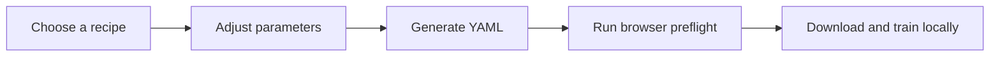

# Finetune Studio

**Design, validate, and export Liquid Finetune configurations from a private,
browser-only workspace.**

[Launch Finetune Studio](https://biolababs.github.io/finetune-studio/) ·
[View the upstream CLI](https://github.com/Liquid4All/liquid-finetune) ·
[Report an issue](https://github.com/biolababs/finetune-studio/issues)

The optional [source bundle](https://github.com/biolababs/finetune-studio/releases/latest/download/finetune-studio-source.tar.gz) brings this browser studio, [WebSLM Trainer](https://github.com/webslm-studio/webslm-trainer), Liquid Finetune, and LLaMA-Factory source into one download. It keeps their training environments separate. The hosted page generates Liquid YAML; local training runs from the downloaded tools. See `bundle/README.md` for setup and supported platforms.

[](https://github.com/biolababs/finetune-studio/actions/workflows/pages.yml)

Finetune Studio is an independent community interface for
[Liquid Finetune](https://github.com/Liquid4All/liquid-finetune). It converts
guided training choices into deterministic YAML without uploading the
configuration or running training on a remote service.

> [!IMPORTANT]
> This project is not affiliated with or endorsed by Liquid AI. The Liquid
> Finetune CLI is the source of truth for complete validation and execution.

## Product workflow



## Capabilities

| Area          | What Finetune Studio provides                                    |
| ------------- | ---------------------------------------------------------------- |
| Guided setup  | Curated starting values for 11 training modes                    |
| Configuration | Deterministic YAML generation with direct editing                |
| Preflight     | Browser-side checks for required fields and recipe compatibility |
| File handling | Local import, copy, and download with no upload step             |
| Handoff       | A ready-to-copy `uv run liquid-finetune ...` command             |
| Delivery      | A dependency-free static build deployable through GitHub Pages   |

## Supported recipes

| Family                 | Recipes            |
| ---------------------- | ------------------ |
| Text tuning            | SFT, DPO, KTO      |
| Retrieval              | Embedding, ColBERT |
| Vision-language        | VLM SFT, VLM DPO   |
| Mixture of experts     | MoE SFT, MoE DPO   |
| Reinforcement learning | GRPO, VLM GRPO     |

These recipes are starting points. Confirm model identifiers, dataset schemas,
reward implementations, compute requirements, and training parameters before
launching a run.

## Use the hosted application

1. Open [Finetune Studio](https://biolababs.github.io/finetune-studio/).
2. Select the closest training recipe.
3. Review the model, dataset, and optimization parameters.
4. Generate YAML and run browser preflight.
5. Download the file into a trusted Liquid Finetune checkout.
6. Run the generated command locally.

Finetune Studio does not install dependencies, download models, access datasets,
or execute training.

## Local development

### Requirements

- Node.js 20 or newer.
- A modern browser.
- No package installation is required; the project has zero runtime
  dependencies.

### Start the preview

```bash
git clone https://github.com/biolababs/finetune-studio.git
cd finetune-studio
npm run dev
```

Open `http://127.0.0.1:4173`. The preview server binds only to loopback and
rejects unrecognized host headers. Select another loopback port with:

```bash
npm run dev -- --port 8088
```

### Run the quality gate

```bash
npm run check
```

To build the source bundle, run `npm run bundle`. This fetches the exact WebSLM Trainer, Liquid Finetune, and LLaMA-Factory commits recorded in `scripts/build-bundle.mjs`, includes the upstream license files, and writes `release/finetune-studio-source.tar.gz`. A push to `main` publishes the archive in GitHub Releases.

The quality gate runs configuration, parser, DOM/privacy, preview-server,
workflow-security, and build-artifact checks. The deployable site is written to
`dist/`.

## Architecture

```text
index.html               Static application shell
src/app.js               Browser interaction and file handling
src/core.js              Recipe data, YAML generation, parsing, and validation
src/styles.css           Responsive visual system
scripts/server-core.mjs  Preview-server security boundaries
scripts/serve.mjs        Loopback-only development server
scripts/build.mjs        Deterministic static build
.github/workflows/       GitHub Pages deployment
.github/dependabot.yml   Automated GitHub Actions update checks
tests/                   Functional, privacy, security, and artifact checks
```

The public site contains only HTML, CSS, and JavaScript. There is no application
API or server-side state.

## Security and privacy

| Boundary           | Control                                                                    |
| ------------------ | -------------------------------------------------------------------------- |
| Configuration data | Remains in the current browser tab                                         |
| Network access     | Blocked for application JavaScript by Content Security Policy              |
| Persistent state   | No cookies, local storage, IndexedDB, database, or telemetry               |
| YAML import        | Limited to 1 MB and treated as text                                        |
| Local preview      | Explicit file allowlist, host validation, and loopback-only bind           |
| Deployment         | Per-job GitHub Actions permissions and non-persistent checkout credentials |

Never add credentials or private data to the repository or static build.
Everything published through GitHub Pages is anonymously downloadable. See
[SECURITY.md](./SECURITY.md) for the reporting process and full security model.

## Validation boundaries

Browser preflight intentionally covers the mapping-based configuration subset
used by the guided recipes. Advanced YAML sequences, custom reward code, local
paths, environment setup, model compatibility, and runtime behavior must be
validated by Liquid Finetune in the target environment.

## Deployment

Pushes to `main` run the test suite, build the static artifact, and deploy it
through GitHub Pages. Dependabot checks the GitHub Actions dependencies weekly.

## Contributing

Focused issues and pull requests are welcome. Before submitting a change:

1. Keep the browser application free of network and persistent-storage calls.
2. Do not introduce a backend without an approved design and threat model.
3. Add tests for behavior and security boundaries affected by the change.
4. Run `npm run check` and ensure the complete gate passes.

## Disclaimer

Finetune Studio is an unofficial community project and is not affiliated with,
sponsored by, or endorsed by Liquid AI. Generated configurations are provided
as starting points and do not guarantee compatibility, performance, safety, or
training results. Users are responsible for reviewing configurations, securing
their environment, and complying with all applicable model, dataset, software,
and content licenses.

Liquid Finetune and associated product names belong to their respective owners.
This repository contains only the Finetune Studio interface and does not
redistribute Liquid Finetune itself.
